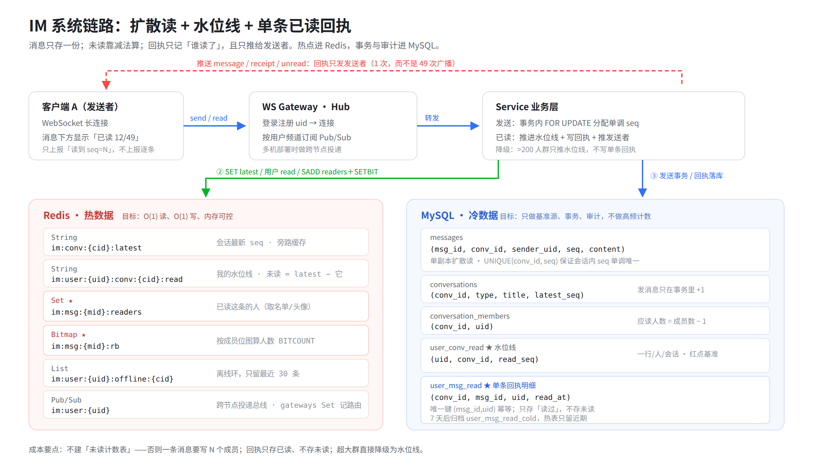

# IM 系统设计说明：扩散读 · 水位线 · 单条已读回执

> 配套代码：`im/`（Go + MySQL 8 + Redis 7 + 原生 WebSocket）
> 配套图：`docs/architecture.png`（源文件 `docs/architecture.svg`）
> 实拍：`docs/screenshots/50-read-chat.png`、`docs/screenshots/50-receipt-modal.png`

---

## 0. 一页纸结论

| 问题 | 答案 | 代价 |
| --- | --- | --- |
| 消息怎么存 | **只存一份**（扩散读），每人按 `seq` 游标读同一份 | 读放大 → 用索引 + 分页抵消 |
| 未读数怎么来 | `未读 = conversations.latest_seq − user_conv_read.read_seq` | **O(1) 减法**，不建未读计数表 |
| 谁读了我的消息 | Redis `Set im:msg:{id}:readers` + MySQL `user_msg_read` | 写放大 → 降级 + 归档 |
| 已读人数怎么算 | `SCARD` / `BITCOUNT`，O(1) / O(M/8) | 内存换时间 |
| 大群怎么办 | `>200 人` 只推进水位线，**不写单条回执** | 精度换成本，保主链路 |
| 成本大头 | 回执明细行数、readers Set 内存 | 靠阈值 + TTL + 冷归档压住 |

一句话：
> **能用减法算的，绝不落一行；能只推一个人的，绝不广播全群；能不精确的（超大群），提前降级。**



---

## 1. 系统怎么跑

### 1.1 模块边界

```
浏览器(web/) ──WS──> internal/api(升级 /ws) ──> internal/ws(Hub：连接注册、Pub/Sub 路由)
                                                   │
                                                   ▼
                                        internal/service(业务编排)
                                          ├── internal/db/store.go  → MySQL（基准源）
                                          └── internal/db/cache.go  → Redis（热数据）
```

- **api**：REST（会话/消息/成员/回执快照）+ WebSocket 升级。
- **ws**：每连接一个 `Client`，`Hub` 维护 `uid → []Client`，并订阅 `im:user:{uid}` 频道做跨节点投递。
- **service**：唯一懂业务的地方（发送、已读、回执、降级判断）。
- **store / cache**：同一份领域模型的两个存储面，**MySQL 是真相，Redis 是加速**。

### 1.2 六条链路

| # | 链路 | 关键动作 | 复杂度 |
| --- | --- | --- | --- |
| ① | 发消息 | 事务 `SELECT latest_seq FOR UPDATE` → `+1` → 插消息 → 提交；Redis `SET latest`；`PUBLISH` 给在线成员，离线写环 | O(1) 写 + 1 次推送/人 |
| ② | 收消息 | 在线：Pub/Sub → 连接；离线：`im:user:{u}:offline:{c}` 只留最近 30 条 | O(1) |
| ③ | 拉历史 | `WHERE conv_id=? AND seq<=? ORDER BY seq DESC LIMIT 50`，走 `UNIQUE(conv_id,seq)` 反向扫 | O(logN + 50) |
| ④ | 标已读 | 推进水位线 → 把 uid 写进区间内每条消息的 Set/Bitmap → 落 `user_msg_read` → 推回执给发送者 | O(本次读的消息数 ≤ 50) |
| ⑤ | 拉未读 | 会话列表 SQL 里 `latest_seq − read_seq`，**一次查询算完所有会话** | O(会话数) |
| ⑥ | 看回执 | `SCARD` 取人数、`SMEMBERS` 取名单；点开才拉，不随消息推送 | O(1) / O(读者数) |

### 1.3 协议

统一信封 `{"type": "...", "data": {...}}`，业务字段全部放在 `data` 里（这一点踩过坑：扁平结构会导致服务端解析出 `uid=0`）。
类型：`login / send / read / sync` → `welcome / ack / message / unread / receipt`。

---

## 2. 三个特殊点（面试重点）

### 2.1 扩散读：消息只写一次，读的时候再"扩散"

**写扩散**（每个成员收件箱存一份）在 500 人群里，一条消息要写 500 行；1000 条消息 = 50 万行。
**扩散读**只写 1 行消息 + 1 次 `latest_seq+1`，成员各自用自己的 `seq` 游标来读。

- `seq` 在**会话内单调递增**，由 `SELECT ... FOR UPDATE` 在事务里分配，天然解决并发抢号。
- `UNIQUE(conv_id, seq)` 兜底，重复即失败，不会出现两个"第 8 条"。
- 代价是"读放大"：一次拉 50 条要扫索引。用 `(conv_id, seq)` 唯一索引 + 游标分页，稳定 O(logN+50)。

> 什么时候该写扩散？只有"读极多、写极少、且成员固定"的场景（如 Feed 大 V 的粉丝收件箱）。IM 消息是写多读也多，扩散读更划算。

### 2.2 水位线：未读数不是"数"出来的，是"减"出来的

```sql
-- 会话列表一次算完，不需要遍历消息（简化示意，完整版还带标题/成员数/最后一条预览）
SELECT c.conv_id, c.latest_seq, COALESCE(MAX(r.read_seq), 0) AS read_seq
FROM conversation_members cm
JOIN conversations c ON c.conv_id = cm.conv_id
LEFT JOIN user_conv_read r ON r.conv_id = c.conv_id AND r.uid = ?
WHERE cm.uid = ? GROUP BY c.conv_id;
-- 未读 = latest_seq - read_seq（应用层一次减法）
```

对比"未读计数表"：

| 方案 | 发一条消息的写 | 查一个会话未读 | 50 人群、日 1000 条 |
| --- | --- | --- | --- |
| 未读计数表 | 给 **每个成员** `UPDATE unread+1` | `SELECT count` | 5 万次写/天 |
| **水位线（本项目）** | `latest_seq+1` **一行** | 一次减法 | **1000 次写/天** |

省的是 **M 倍写**（M=群成员数），而且不需要"已读时把 N 条未读逐条标记已读"，一次 `read(seq)` 全清。

### 2.3 单条回执：Set 存名单，Bitmap 算人数

飞书和微信的差别就在这：微信只需要红点，飞书要回答"这条消息**谁**读了、**几个人**读了"。

| 结构 | Key | 用途 | 复杂度 | 单条成本（50 人全读） |
| --- | --- | --- | --- | --- |
| Set | `im:msg:{mid}:readers` | 取名单、头像、判断某人是否已读 | `SADD`/`SISMEMBER` O(1)，`SMEMBERS` O(r) | ≈ 600–700 B |
| Bitmap | `im:msg:{mid}:rb` | 只算人数，`BITCOUNT` | O(M/8 字) | ≈ 7 B（50 人） |

为什么两个都要：

- **Set 是"名单"**：UI 要展示前 5 个头像、点开看 49 人名单，必须有 uid。
- **Bitmap 是"计数器"**：1000 人群若只问"几个人读了"，Set 要 1000×~20B=20KB，Bitmap 只要 125B。**人数查询走 Bitmap，名单按需走 Set**。
- Bitmap 的位下标由 `im:conv:{cid}:midx`（uid → 成员序号 Hash）分配，成员进出不会错位。

回执写路径（一次 `read`）：

```
read(seq=N)
  ├─ 推进 user_conv_read.read_seq = N          （红点消失）
  ├─ 对 [old+1, N] 内每条消息（最多 50 条）：
  │    SADD readers uid  +  SETBIT rb idx 1
  │    INSERT user_msg_read（唯一键幂等，审计/回填）
  └─ 只向 sender 推送 receipt{read_count, total, readers}
```

**只推发送者**是第二个"省"：50 人群一条消息被 12 人读，如果广播给全群就是 12×50=600 次推送；只推发送者是 12 次。

### 2.4 实拍（50 人「产品发布协作群」，12 人已读）


- 应读人数 = 50 − 1 = **49**（发送者不算），12 人已读 → `已读 12/49`，未读 37。
- 50 人 < 阈值 200，所以**没有降级**，是逐人精确回执。

---

## 3. Redis 设计

### 3.1 Key 总表

| Key | 类型 | 写 | 读 | 复杂度 | 建议 TTL | 丢了会怎样 |
| --- | --- | --- | --- | --- | --- | --- |
| `im:conv:{cid}:latest` | String | 发消息 `SET` | 算未读/拉历史 | O(1) | 永久（可重建） | 从 `conversations.latest_seq` 回填 |
| `im:user:{uid}:conv:{cid}:read` | String | 已读 `SET` | 算未读 | O(1) | 永久（可重建） | 从 `user_conv_read` 回填 |
| `im:msg:{mid}:readers` | Set | `SADD` | `SMEMBERS`/`SCARD`/`SISMEMBER` | O(1)/O(r) | **24–48h**（回执详情看近期） | 从 `user_msg_read` 回填 |
| `im:msg:{mid}:rb` | Bitmap | `SETBIT` | `BITCOUNT` | O(M/8) | 同 readers | 可重算 |
| `im:conv:{cid}:midx` | Hash | 新成员 `HSET` | `HGET` 取位号 | O(1) | 永久 | 重新分配（位图失效） |
| `im:user:{uid}:offline:{cid}` | List | `LPUSH`+`LTRIM` | 上线 `LRANGE` | O(1) | 7d | 用户重新 `sync` 拉历史 |
| `im:user:{uid}:gateways` | Set | 连接注册/心跳 | 跨节点路由 | O(1) | 心跳过期 | 重新注册 |
| `im:user:{uid}` | Pub/Sub | `PUBLISH` | 订阅投递 | O(订阅者) | — | 在线消息丢，靠离线环/同步兜底 |

> 本仓库 demo 为了好观察没有设 TTL；生产必须给 `readers`/`rb` 设 TTL，否则内存随消息量线性涨。

### 3.2 为什么用 String 存水位线，而不是 Hash

- 访问模式是"**单字段整取整存**"（`GET` / `SET` 一个 seq），String 最省。
- 用 `Hash(uid → read_seq)` 看似省 key，但大 Hash 会变成"热 key + 大 value"，扩容和迁移都难受；拆成 `uid:conv` 粒度可以按用户分片。
- 若一个用户几万会话，可用 `Hash` 按 uid 聚合 + 分片，属于规模化优化，不是第一天的选择。

### 3.3 内存账（按假设测算）

假设：50 人群、日 5 万条消息、全部已读、readers Set 保留 7 天。

| 项 | 单条/单元 | 数量 | 合计 |
| --- | --- | --- | --- |
| readers Set（50 个整型 uid，intset 编码） | ≈ 500 B（含 key） | 35 万条 | **≈ 175 MB** |
| Bitmap（50 位） | ≈ 100 B（含 key） | 35 万条 | ≈ 35 MB |
| 水位线 String | ≈ 70 B | 1 万用户 × 20 会话 | ≈ 14 MB |
| 离线环（cap 30） | ≈ 6 KB（仅离线时） | 峰值 1 万 × 3 会话 | ≈ 180 MB（可 TTL 压到很小） |

> 前提：uid 是整数，Redis 用 `intset`（默认 ≤512 个元素）存，约 8 B/人；若存字符串 uid 会退化为 `listpack/hashtable`，单条约 1–1.5 KB，成本翻倍——**uid 用整型不只是习惯，是省内存**。

结论：**readers Set 是 Redis 最大头**。两条降本手段：
1. TTL 从 7 天降到 24–48 小时（回执详情 99% 只看当天）→ 175MB 降到 25–50MB。
2. 超大群直接不建 Set（见 3.4），内存与人数解耦。

### 3.4 降级：把"贵"的能力关掉，而不是拖垮主链路

| 触发条件 | 行为 | 省掉 |
| --- | --- | --- |
| 成员数 > `BIG_GROUP_THRESHOLD`（默认 200） | 只推进水位线，**不写 Set/Bitmap/明细，不推回执** | 每条消息 M 次 SADD + M 行 INSERT |
| 单次 `read` 覆盖 > 50 条 | 只给最近 50 条写回执 | 离线一周上线导致的写风暴 |
| `RECEIPT_DEGRADE=1`（大促/故障开关） | 全局只保留水位线 | 回执全链路成本 |

500 人群若不做降级：一条消息 499 行回执，日 5 万条 = **2495 万行/天**。降级后 = **0 行**。

---

## 4. MySQL 设计

### 4.1 表与索引

| 表 | 主键 | 关键索引 | 为什么这么设计 |
| --- | --- | --- | --- |
| `conversations` | `conv_id` | — | `latest_seq` 是全会话的"写热点"，一行一个计数器 |
| `messages` | `msg_id` | **`UNIQUE(conv_id, seq)`** | 拉历史/去重/游标全靠它；消息只存一份 |
| `conversation_members` | `(conv_id, uid)` | `idx_uid(uid)` | 反查"我在哪些群"；应读人数 = count − 1 |
| `user_conv_read` | `(uid, conv_id)` | — | 一人一会话一行，红点基准 |
| `user_msg_read` | `id` | **`UNIQUE(msg_id, uid)`** + `idx(conv_id)` | 幂等（重复已读不膨胀）；按会话归档 |
| `user_msg_read_cold` | `id` | `idx(conv_id)` | 7 天外冷数据，热表保持小 |

### 4.2 事务边界

只有"发消息"需要事务：

```sql
BEGIN;
SELECT latest_seq FROM conversations WHERE conv_id=? FOR UPDATE;  -- 行锁，串行分配
UPDATE conversations SET latest_seq = latest_seq + 1 WHERE conv_id=?;
INSERT INTO messages(conv_id, sender_uid, seq, content) VALUES (...);
COMMIT;
```

- **必须在一个事务里**：否则两个并发发送会拿到同一个 seq。
- **已读不进这个大事务**：水位线一行 + Set 若干 + 明细若干，允许最终一致；失败可重试/回填，不能拖住发送。

### 4.3 存储账

| 数据 | 单行估算 | 50 人群、日 5 万条 | 7 天 |
| --- | --- | --- | --- |
| `messages` | ≈ 300 B（含索引/页开销） | 15 MB/天 | 105 MB |
| `user_msg_read`（全读） | ≈ 100 B | 245 万行 ≈ **245 MB/天** | **1.7 GB** |
| `user_conv_read` | ≈ 40 B | 按人增长，可忽略 | — |

回执明细是**唯一会爆的表**。三条控制线：
1. **阈值降级**：>200 人不写（大群 0 行）。
2. **只存已读**：未读不落库，靠"成员 − 已读"派生。
3. **7 天归档**：热表只留近期，冷表/对象存储承接审计查询。

---

## 5. 成本与时间：到底省在哪

### 5.1 成本对照（同一业务量：日 5 万条、群均 20 人）

| 设计选择 | 朴素做法 | 本项目 | 量级 |
| --- | --- | --- | --- |
| 未读计数 | 每条消息 × M 行写：100 万次/天 | `latest_seq+1`：5 万次/天 | **省 20×**（=M） |
| 回执存储 | 每人每条一行 + 未读也存 | 只存已读 + 大群不存 | 大群 **省 100%** |
| 回执推送 | 广播全群：12×20=240 次 | 只推发送者：12 次 | **省 20×** |
| 离线消息 | 每人每会话存全量 | 环 cap 30 条 | 内存 **有上限** |
| 历史消息 | 每成员一份（写扩散） | 单副本 | 存储 **省 M×** |

### 5.2 时延对照

| 操作 | 朴素 | 本项目 | 说明 |
| --- | --- | --- | --- |
| 拉会话未读 | `COUNT(*)` 扫消息表 O(n) | 一次 JOIN + 减法 O(会话数) | 50 人群 49 人批量：**6.3 ms vs 31 ms（4.9×）** |
| 未读随消息增长 | 线性变慢 | **恒定** | 未读 4001 条时差距拉大到 **7.2×** |
| 已读人数 | `SMEMBERS` + `len` O(r) | `SCARD` O(1) / `BITCOUNT` O(M/8) | 大群差距指数级 |
| 已读上报 | 每条一次 RTT | 一次 `read(seq)` 覆盖 ≤50 条 | **N 次 RTT → 1 次** |
| 拉历史 | 全表扫 | 唯一索引反向扫 50 条 | O(logN+50) |

> 实测来自 `cmd/bench_unread`（50 人群、4001 条消息），可复现：
> `curl -X POST 'localhost:8080/api/seed_big?n=50' && go run ./cmd/bench_unread`

### 5.3 还可以更省（生产优化清单）

| 优化 | 收益 | 代价 |
| --- | --- | --- |
| 回执推送只带 `read_count`，点开再拉名单 | 推送体积从 O(r) 降到 O(1) | 多一次请求 |
| `SADD`/`SETBIT`/`INSERT` 走 pipeline + 批量 INSERT | 一次已读的 RTT 从 ~150 次降到 3 次 | 代码复杂度 |
| readers Set TTL 24h | Redis 内存降 3–7× | 更早的回执需查 MySQL |
| `user_msg_read` 按月分区 | 归档不锁表、删除快 | 运维复杂度 |
| 未读数本地缓存（客户端 watermark） | 会话列表 0 查询 | 多端同步复杂 |

---

## 6. 一致性与故障

| 场景 | 处理 | 结果 |
| --- | --- | --- |
| Redis 挂了 | 水位线从 MySQL 读；回执 Set 丢失可由 `user_msg_read` 回填 | 短时回执不准，消息不丢 |
| 发送成功但推送失败 | 消息已落库；客户端重连 `sync` 按 seq 补齐 | 不丢消息 |
| 用户离线 | 写入离线环（cap 30），上线补推，再 `sync` 兜底 | 最多补 30 条 + 历史拉取 |
| 重复已读 | `UNIQUE(msg_id,uid)` + `SADD` 幂等 | 计数不膨胀 |
| 大群/高峰 | 阈值 + 开关降级，只保水位线 | 回执不精确，主链路稳定 |

**顺序原则**：先落 MySQL（真相），再写 Redis（加速）；Redis 失败只影响体验，不影响正确性。

---

## 7. 面试 30 秒版

> 这个 IM 用"扩散读"：消息只存一份，会话内用 `seq` 单调递增，成员各拿各的游标读。
> 未读不建计数表，`latest_seq − read_seq` 一次减法，O(1)。
> 飞书式已读回执用 Redis Set 存"谁读了"、Bitmap 算人数，回执只推给发送者。
> 成本上做三道闸：单次已读最多补 50 条、超 200 人的群只留水位线、回执明细 7 天归档。
> 结果：50 人群拉未读比 `COUNT(*)` 快约 5 倍且不随消息量变慢，大群回执成本直接归零。

---

## 8. 复现

```bash
cd im
docker compose up -d
curl -X POST localhost:8080/api/seed        # 4 人演示数据
curl -X POST 'localhost:8080/api/seed_big?n=50'  # 50 人压测群
go run ./cmd/smoke                          # 已读回执全链路冒烟
go run ./cmd/bench_unread                   # 水位线 vs COUNT(*) 基准
```

界面：浏览器打开 `http://localhost:8080/`，用两个窗口登录不同身份；发送者消息下方即出现「已读 X/Y」，点开是双列已读/未读名单。
