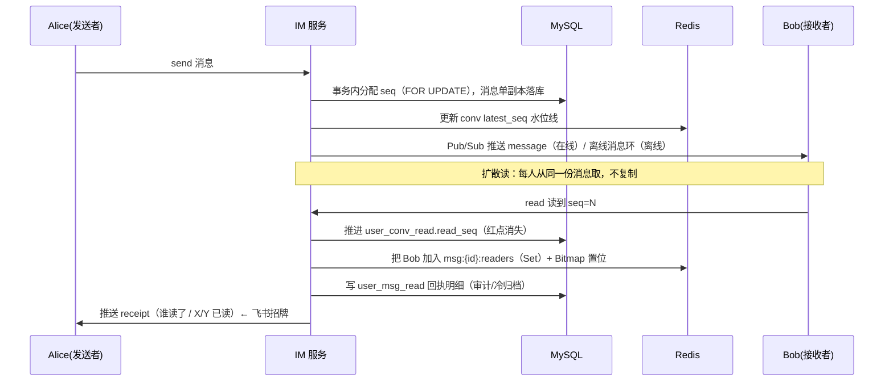

# cyberspace-cs · 飞书式 IM 教学项目（单条已读回执）

> 从零到一实现一个 **飞书 / 钉钉 B 端风格** 的即时消息系统：扩散读 + 会话红点水位线 + **单条消息已读回执**。
> 代码逐条对应「大厂 IM 系统设计对比」，是面试时横向对比 Redis+MySQL 选型的最佳样本。

- GitHub：https://github.com/cyberspace-cs/cyberspace-cs （**本 IM 项目位于 `im/` 子目录**，与原仓库其它项目共存）
- Gitee：https://gitee.com/buleboy8065/cyberspace-cs （独立仓库，IM 项目在根目录）
- 线上演示（部署后）：http://taoxie.vip/im/

---

## 1. 这个项目和「大厂对比」怎么对应

你整理的对比表里，**飞书 / 钉钉（B 端办公 IM）** 这一段，就是本项目的实现目标：

| 对比项 | 本项目的落地 |
| --- | --- |
| MySQL 角色 | `messages`（单副本扩散读）、`user_conv_read`（会话水位线）、`user_msg_read`（单条回执明细，7 天归档冷存储） |
| Redis 角色 | `Set msg:{msgId}:readers`（已读 uid）、`Bitmap`（批量统计已读人数）、`String`（latest_seq / read_seq 水位线）、`List`（离线消息环）、`Set`（网关路由） |
| 核心矛盾 | 单条回执写入量巨大（每条被读都写一行） |
| 一致性 | 回执尽量准；**超大群 / 高峰期可降级**，优先保消息收发主链路 |

一句话区分（面试口述）：
> **C 端微信**用「水位线」做红点，**只存用户读到的最大 seq**；**B 端飞书**额外给「每一条消息」记谁读了（已读回执）；**直播大群**直接放弃服务端精确未读数，改客户端拉取。

---

## 2. 快速开始（本地 Docker 一键起）

```bash
cd im                          # GitHub 仓库需先进入 im/ 子目录（Gitee 仓库在根目录，无需 cd）
docker compose up -d          # 起 MySQL8 + Redis7 + IM 服务
curl -X POST http://localhost:8080/api/seed   # 灌入演示数据（4 用户 + 单聊 + 群聊）
# 浏览器打开 http://localhost:8080/ ，分别在两个窗口选不同身份登录即可体验
```

端到端冒烟测试（需服务已启动，验证飞书式已读回执全链路）：

```bash
cd im
go run ./cmd/smoke            # Alice 发群消息 → Bob/Carol 收到 → 已读 → Alice 收回报执
```

手动构建运行：

```bash
cd im
export MYSQL_DSN='root:rootpass@tcp(127.0.0.1:3306)/im?parseTime=true&charset=utf8mb4&loc=Local'
export REDIS_ADDR=127.0.0.1:6379
go run ./cmd/server
```

---

## 3. 架构总览



---

## 4. 数据模型

### MySQL（持久化基准源）
| 表 | 作用 | 关键字段 |
| --- | --- | --- |
| `users` | 用户 | uid, name |
| `conversations` | 会话 | conv_id, type(1单聊/2群), **latest_seq** |
| `conversation_members` | 成员关系 | conv_id, uid |
| `messages` | 消息（**单副本扩散读**） | msg_id, conv_id, sender_uid, **seq（UNIQUE(conv_id,seq)）** |
| `user_conv_read` | **会话水位线（红点基准）** | uid, conv_id, read_seq |
| `user_msg_read` | **单条已读回执明细** | conv_id, msg_id, uid（7 天外归档 `user_msg_read_cold`） |

### Redis（热点 / 计数 / 回执 / 路由）
| Key | 结构 | 作用 |
| --- | --- | --- |
| `im:conv:{id}:latest` | String | 会话最新 seq（旁路缓存） |
| `im:user:{uid}:conv:{id}:read` | String | 用户在该会话的读水位线 |
| `im:msg:{msgId}:readers` | Set | **已读这条消息的 uid 集合（飞书回执）** |
| `im:msg:{msgId}:rb` | Bitmap | 按成员位统计已读人数（群大时替代 SMEMBERS 省内存） |
| `im:user:{uid}:offline:{convId}` | List(环形) | 离线消息环，只留最近 N 条 |
| `im:user:{uid}:gateways` | Set | 用户当前连在哪台机器（网关路由） |
| `im:user:{uid}` | Pub/Sub | 跨节点投递总线 |

---

## 5. 核心流程：飞书式已读回执是怎么做的

1. **发消息**：MySQL 事务里 `SELECT latest_seq ... FOR UPDATE` 分配单调递增 `seq`，消息只存一份；Redis 更新 `latest_seq`；再经 Pub/Sub 把消息推给在线成员，离线成员写入「离线消息环」。
2. **标记已读**：客户端上报读到的最大 `seq`。服务端：
   - 推进 `user_conv_read.read_seq` → 会话红点基于 `latest_seq - read_seq` 消失；
   - 把该用户写进区间内**每条消息**的 `Set`（读者集合）+ `Bitmap` 置位；
   - 落库 `user_msg_read`（审计，生产按 7 天归档冷存储）；
   - 把回执（谁读了 / X/Y 已读）推给**消息发送者** —— 这就是飞书「看到谁读了我的消息」。
3. **降级保护**：
   - 单次「已读」只给最近 50 条消息写回执，避免一次读 1000 条导致写放大；
   - 成员数超过 `BIG_GROUP_THRESHOLD`（默认 200）的**超大群**，或 `RECEIPT_DEGRADE=1` 时，**只推进水位线、不再维护单条回执**，优先保住消息收发主链路。

---

## 6. 横向对比（面试直接背）

| 系统 | 核心矛盾 | MySQL 作用 | Redis 核心结构 | 一致性要求 |
| --- | --- | --- | --- | --- |
| **C 端 IM（微信）** | 群扩散写爆炸、红点高频查 | 水位线、消息持久化 | String、Bitmap、RingBuffer | 最终一致，红点允许短暂不准 |
| **B 端 IM（飞书/钉钉）** | 回执写入量巨大 | 单条消息回执明细 | **Set、Bitmap** | 回执尽量准，高峰可降级 |
| Feed 社交（微博） | 大 V 发动态写放大 | 博文、关系流水 | ZSet、Hash、分片 Counter | 最终一致 |
| 电商秒杀 | 防超卖、高并发抢券 | 库存、订单事务 | String、Lua、分布式锁 | 库存强一致，计数可异步 |
| 直播弹幕 | 瞬时 QPS 极高 | 主播配置、封禁 | List、ZSet、Stream | 弱一致，在线数允许误差 |
| Agent 大模型平台 | 会话上下文、工具并发 | 会话、计费、日志 | Hash、String、Stream | 配额强一致，会话状态最终一致 |

**加分话术**：
> 不同系统的 Redis+DB 设计，本质都是「识别热点路径，把读多写多、允许短暂不一致的热点放 Redis；事务、审计、不可丢失的基准数据放 MySQL」。
> IM 重点是区分 **C 端红点水位线** 和 **B 端单条回执**；Feed 是 fanout 推流 + ZSet 收件箱；电商核心是库存 Lua 原子扣减；Agent 平台用 Redis 做会话状态、模型路由、token 限流。
> 同时按规模降级：超大群放弃精确未读、热点计数分片、B 端回执高峰期降级，优先保住主链路。

---

## 7. 部署到 taoxie.vip/im

1. 服务器 `43.143.231.106`（taoxie.vip 已解析到此 IP），用户 `ubuntu`。
2. 已准备好 `nginx.conf`（把 `/im/` 反代到本地 8080，支持 WebSocket 升级）。
3. 提供 `deploy.sh`：同步代码 → `docker compose up -d` → 写入 nginx 反代 → reload。
4. 执行需服务器 SSH 私钥（`id_ed25519_audit_server`）。当前沙箱未持有该密钥，脚本已就绪，提供密钥后即一键上线；在此之前可用 `docker compose up -d` 在任意机器本地验证。

---

## 8. 目录结构

```
cmd/server/main.go        入口：装配 store/cache/hub/http
internal/config           环境变量配置
internal/db               MySQL(store.go) + Redis(cache.go) + schema.sql
internal/model            领域模型
internal/protocol         WebSocket JSON 协议
internal/ws               WebSocket 网关（Hub + 客户端 + Pub/Sub 跨节点路由）
internal/service          业务逻辑（发消息 / 已读回执 / 水位线 / 降级）
internal/api              REST + WS 升级
web/                     演示前端（红点 + 已读回执展示）
docker-compose.yml / Dockerfile / nginx.conf / deploy.sh
```
