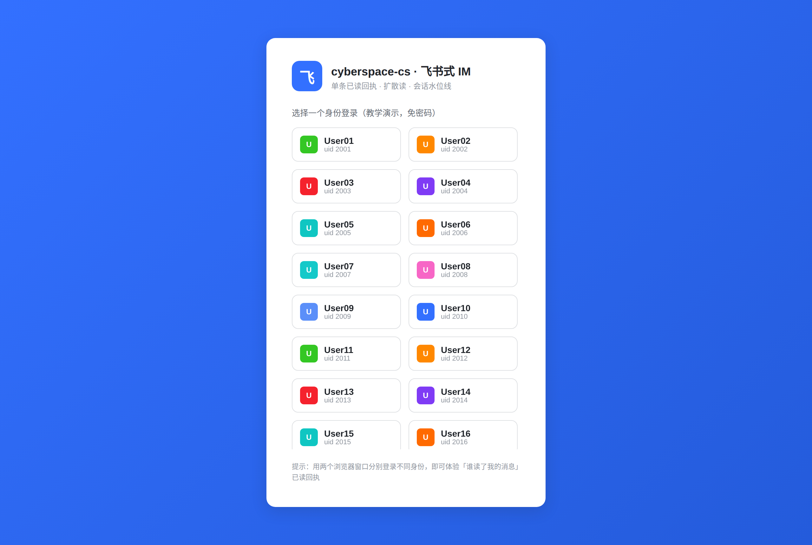
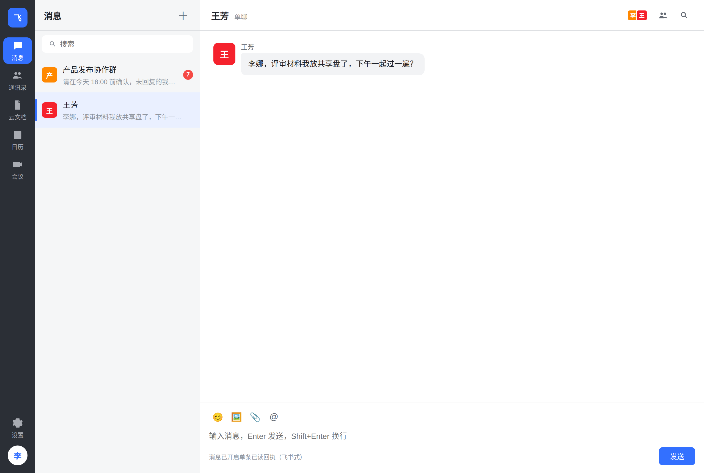
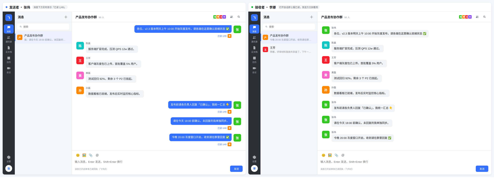
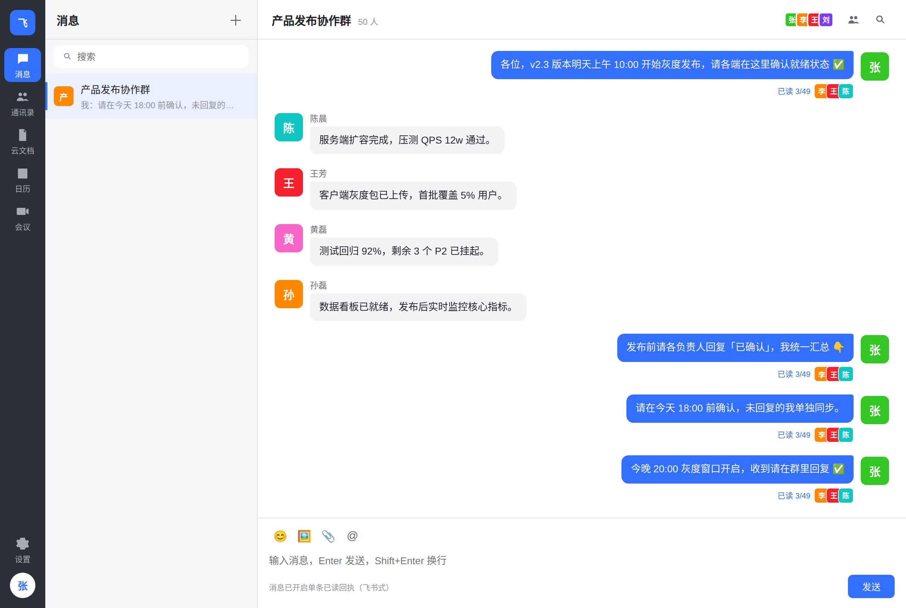
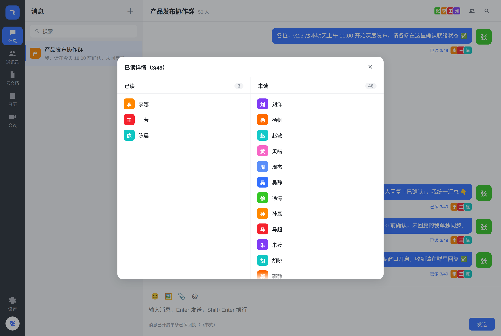

# 核心功能联调报告

> 时间：2026-10-29 12:10　环境：Go 服务 + MySQL 8.0 + Redis 7，Chromium 双浏览器窗口
> 场景：50 人「产品发布协作群」（应读 49 人），张伟(3001) 发送，李娜(3002) 阅读，王芳(3003)、陈晨(3005) 补读
> 方式：**真实 WebSocket 双端**（不是接口 mock），每一步用 Playwright 断言并截图

## 一、结果：11 / 11 通过

| # | 用例 | 结果 | 观测 |
| --- | --- | --- | --- |
| 1 | 登录页渲染身份列表 | ✅ | 100 个演示身份 |
| 2 | 未读会话显示红点 | ✅ | 群 `7`，1:1 自动打开后为 0 |
| 3 | 发送方消息即时上屏 | ✅ | 走 `ack`，无需刷新 |
| 4 | 未被阅读时显示「已送达」 | ✅ | 回执行文案 |
| 5 | 接收方红点实时 +1 | ✅ | 7 → 8 |
| 6 | 对方打开会话后回执实时更新 | ✅ | 已读 1/49 |
| 7 | 多人补读后人数累加 | ✅ | 已读 3/49（李/王/陈） |
| 8 | 回执详情弹窗 | ✅ | 已读详情（3/49），左已读 3 / 右未读 46 |
| 9 | 重复已读幂等 | ✅ | 再读一次仍为 3/49 |
| 10 | 历史消息落库 | ✅ | 8 条（原 7 条 + 新增 1 条） |
| 11 | 已读后未读归零 | ✅ | `unread=0` |

## 二、实拍

### 1. 登录页（100 个演示身份，免密码）



### 2. 未读红点：李娜尚未打开群，右侧显示 7



### 3. 双端联调：左发送者「已读 1/49」，右接收者实时收到



### 4. 王芳、陈晨补读后：已读 3/49



### 5. 回执详情：左已读 3，右未读 46



## 三、本轮联调发现并修复的问题

| 问题 | 现象 | 修复 |
| --- | --- | --- |
| 会话列表无排序 | 新建会话可能排在末尾，最近活跃的群不在顶部 | SQL 增加 `ORDER BY 最后一条消息时间 DESC` |
| 消息倒序渲染 | 接口按 `seq DESC` 翻页，前端直接渲染 → 最新消息跑到最上面 | 渲染前 `sort((a,b)=>a.seq-b.seq)` |
| 当前会话红点不清零 | 打开会话后角标还在；`refreshConvs` 又把服务端旧值贴回来 | 打开即本地置 0 + 刷新时保护 active 会话 |
| 时区不一致 | MySQL 容器 UTC、种子数据 +08，新消息时间差 8 小时、排序错乱 | `docker-compose` 增加 `TZ=Asia/Shanghai` + `--default-time-zone=+08:00` |
| 登录页溢出 | 100 个身份撑破屏幕，头部被顶出 | 卡片 `max-height:86vh`，身份列表内部滚动 |
| emoji 显示方框 | 截图里 ✅ 👇 变豆腐块 | 安装 `Noto Color Emoji` 字体（环境问题，非代码） |

## 四、复现

```bash
cd im
docker compose up -d
curl -X POST localhost:8080/api/seed
curl -X POST 'localhost:8080/api/seed_big?n=50'
# 浏览器开两个窗口：一个登 3001 张伟，一个登 3002 李娜，互发消息即可
```

自动化脚本与断言思路见本报告表格；截图均为真实页面（Playwright 2x 截图）。
